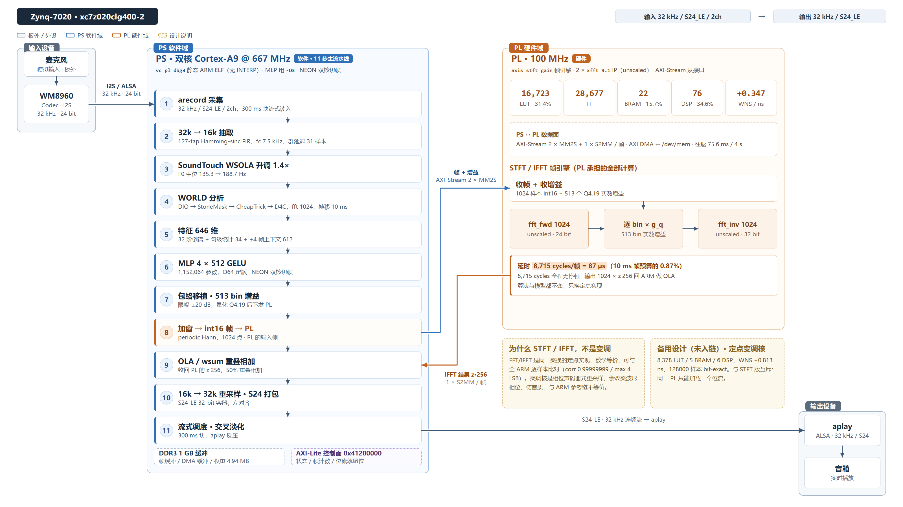

# 设计报告：Zynq-7020 上的实时音色转换系统

- 作品名称：基于 Zynq-7020 的固定目标音色实时转换（VC-7020）
- 组别：初级组
- 器件：`xc7z020clg400-2`（野火皓月 Zynq-7020 开发板）
- 工具：Vivado / SDK **2018.3**（赛事推荐 2026.1 或 2025.2，**差异说明见第 5.3 节**）
- 日期：2026-10-27（首版 2026-10-26，本次为增量修订）
- 定版模型：**O64**（64 阶倒谱输出，1,152,064 参数，blob 4,941,804 B）
- 演示档位：**O64 + `--preset live`**（2026-10-27 实测 RTF 0.860、60 s 0 欠载）
- 代码与数据：本参赛包根目录

---

## 1. 摘要

把一段男声（16 kHz/32 kHz）转换成**固定目标女声的音色**，并在 Zynq-7020 的
双核 Cortex-A9 上做到接近实时、可听、可复现。

| 维度 | 结果 | 备注 |
|---|---|---|
| 功能 | 4 s 批处理、23.72 s O64 整段、30 min 流式（live 档）均跑通，输出长度/格式正确 | 板上实测 |
| 算法 | WORLD 分析 → 513 bin 对数谱 → 32 阶 DCT 倒谱 → 646 维特征 → 4×512 MLP → 64 阶倒谱残差 → 包络移植 | 与 Python 参考逐阶段对齐 |
| 性能 | 4 s 批处理 **3857–3941 ms（RTF 0.967–0.985，T4/48 阶）**；**O64 + live 档 3440 ms（RTF 0.860）**；O64 精确档 5380 ms（RTF 1.345） | 三次实测 / 单次 |
| 实时 | 300 ms 块 + `--preset live`：**6000/6000 块、0 欠载、RSS 恒定 8,172 KB**（T4 30 min）；O64 live 60 s **0 欠载**、处理 p50/p99 **276.0 / 284.8 ms**、端到端 p99 **584.8 ms** | 见 §6.2、§6.2a |
| PL | **PL 承担 STFT/IFFT + 逐 bin 乘法**：16,723 LUT / 22 BRAM / 76 DSP、WNS **+0.347 ns**；端到端 **corr 0.99999999 / max 4 LSB**，STFT 段 **449.04→305.82 ms**、RTF **0.9376→0.9019** | 见 §6.8 |
| 一致性 | 板端 vs Python 参考 **121.71 dB**；ARM vs x86 **139.38 dB**；O64 板端 vs Python O64 **corr 0.999999987 / SNR 75.71 dB**；PL STFT vs 全 ARM **corr 0.99999999 / 4 LSB** | 见 §6.6 |
| 质量（O64，两种档位） | 精确档 identity **0.7293** / UTMOS **2.2659** / 泄漏 **−0.0223**；live 档 identity **0.7321** / UTMOS **2.1900** / 泄漏 **−0.0346** | 23.72 s 10 窗；**UTMOS 差门禁 0.034（精确档）/ 0.110（live 档）** |

> 口径：质量行两种档位都列（精确档 = 质量上限，live 档 = 演示档，代价主要在 UTMOS −0.076）；
> 实时行 T4 来自 30 min 长稳，O64 live 来自本轮 60 s + 30 min（§6.2a）。
> O64 精确档 RTF 1.345 **只能批处理**，演示必须用 live 档——两个口径不混读。

**一句话结论**：功能、数值一致性、性能、PL 资源与吞吐都达到了可交付状态；
**听感质量的绝对门禁（UTMOS ≥ 2.30）仍未达到**（O64 精确档 2.2659 差 0.034，
live 档 2.1900 差 0.110），这是本作品的真实边界，不掩饰（见 §6.4、§8）。

---

## 2. 赛题与约束

| 项 | 要求 | 本作品 |
|---|---|---|
| 器件 | 初级组可用 Zynq-7000 SoC | `xc7z020clg400-2` ✅ |
| 实现方式 | RTL / HLS / AI Engine / PS 软件任意组合 | PS 软件主链 + PL STFT/IFFT 核（RTL）+ 备用变调核 ✅ |
| 工具版本 | Vivado/Vitis 2026.1（推荐）或 2025.2；其它版本须说明并保证脚本可复现 | 2018.3，**已说明 + 提供完整 Tcl 与复现步骤** ✅ |
| 板上跑通 | 须提供实测输出 | 4 s / 23.72 s O64 / 30 min 实测，日志与 SHA 齐全 ✅ |
| 大模型协作记录 | 提示词、回答、自我纠错轨迹 | `ai_collaboration/`（6 组专题 + 28 轮索引 + 原始日志附录）✅ |
| 技能包 | 提炼为可复用 Skill | `skill/` 三条，均含"换题目/换板卡怎么用" ✅ |

---

## 3. 系统架构

_图 3-1　系统总体架构。左侧为 PS（Cortex-A9）软件流水线的 11 个处理步骤，右侧为 PL（100 MHz）承担的 STFT/FFT 与频域增益计算，中间经 AXI-Stream / AXI DMA 交换数据；右上是本设计的 PL 资源占用，右中说明为何 PL 承担 FFT 而非变调。_

- **PS 承担算法**：WORLD 分析与合成、SoundTouch 升调、特征、MLP、包络增益量化、
  窗/OLA/重采样/S24 打包、流式调度。
- **PL 承担 STFT/IFFT + 频域乘法**：ARM 把"窗后 int16 帧 + 513 个 Q4.19 增益"通过
  AXI DMA（2×MM2S + 1×S2MM/帧）送入 PL，PL 做两个 unscaled 1024 点 xfft（前向 24 bit、
  逆向 32 bit）并逐 bin 乘实数增益，结果 `z·256` 回 ARM 做 OLA。实测 8715 cycles/帧 = 87 µs。
- **数据通路**：`fpga/stft/`（当前入链）；`fpga/build/` 的定点变调核是**已验证的备用设计**，
  未入链，且与 STFT 版**不能共存**（同一 PL、同一套 PS7/I2S/DMA/GPIO，切换需重载位流）。
- 详细寄存器映射与 CLI 契约见 [`docs/interface.md`](../docs/interface.md)，
  接线与音频路由见 [`docs/hardware_setup.md`](../docs/hardware_setup.md)。

> **为什么 PL 做 FFT 而不是做变调**：FFT/IFFT 是同一变换的定点实现，**数学等价**，
> 可以逐样本比对（corr 0.99999999 / max 4 LSB）；而变调核是相位声码器式重采样，
> 会改变波形相位、伤音质，且与 ARM 参考链不等价。STFT 版把最"规整"的算子搬上 PL，
> 既拿到 −143 ms 的收益，又不引入不可量化的音质风险（详见 §6.8）。

---

## 4. 算法链（每一步都可追溯到 Python 参考）

| 步 | 处理 | 关键参数 | 与参考的一致性 |
|---|---|---|---|
| 1 | 输入解码 | 32 kHz / S24_LE（32-bit 容器，24 位有效左对齐） | 长度/格式核对 |
| 2 | 32k→16k | 127 抽头 Hamming-sinc，fc 7.5 kHz，群延迟 **31 个 16 kHz 样本** | SNR 46.8 dB（对齐 31 样本） |
| 3 | 升调 | SoundTouch `setPitch(1.4)`，WSOLA | 中位 F0 188.7 Hz（源 135.3，比值 1.395）✅ |
| 4 | WORLD 分析 | f0 75–400 Hz，frame_period 10 ms，fft 1024，D4C thr 0.85 | f0/logsp/ap 在 float32 下 **max\|Δ\|=0** |
| 5 | 特征 | 32 阶 ceps（减句内均值）+ logf0 + voiced + gain + apmean + Δceps → 68；±4 帧上下文 → 612；句级统计 34 → **646** | 相对 RMS 5.5e-8 |
| 6 | MLP | 4×512 GELU（精确 erf），**64 维输出**，1,152,064 参数 | max\|Δ\| 9.2e-5（T4）；O64 整链 75.71 dB |
| 7 | 包络移植 | `diff_db = 0.5(pred−src)·20/ln10`，限幅 ±20 dB，静音 mask 0..1 平滑 | 增益 max\|Δ\| 5.1e-5（T4） |
| 8 | 合成 | ISTFT（periodic Hann, center=True）→ 16k→32k → S24 | 最终波形 **121.71 dB / corr 1.000000** |

O64 只改第 6 步的输出阶数（48→64）与权重 blob，第 1–5、7–8 步不变；C 侧阶数从 blob 头读、
无写死数组（`o64_onboard_20261026.md` §2–3）。

---

## 5. 实现

### 5.1 PS 侧（`host/app/`）

- 单文件 1661 行 `vc_stream.cpp` + `stream_mode.inc`（流式）+ `mlp_int8.inc`（int8 权重）
  + `st_cpu_stub.cpp`（SoundTouch 在非 x86 的桩）。
- 静态 ARM ELF，730–804 KB，无 `INTERP` 段；`-O2`，仅 MLP 用 `optimize("O3")`。
- 定版模型 O64：`student_v5_o64.blob` **4,941,804 B**（`out_dim=64`、`params=1,152,064`）、
  板端 `vc_o64` **804,424 B**；与 `vc_live`（T4/48 阶）同源同尺寸，旧文件全部保留（`o64_onboard_20261026.md` §2、§5）。
- CLI 契约沿用前代 v23 调度器：`vc_stream <seconds> pcm16|native_s24 <prefill_ms>
  [out_gain_q16 [in_gain_q16]] [flags...]`，stderr 输出 JSON 遥测。
- 双核：MLP 按帧切半 + 第二遍 WORLD 并行；失败自动回退串行（遥测 `threaded:false`）。

### 5.2 PL 侧（`fpga/`）

- **当前入链：STFT 版**（`fpga/stft/`）。`rtl/axis_stft_gain.v` 是帧引擎
  （收 1024 样本 → 收 513 个 Q4.19 增益 → 前向 FFT → 逐 bin 乘 → 逆向 FFT → 回 1024 个 `z·256`），
  两个 xfft 9.1 作独立 IP cell（前向 24 bit / 逆向 32 bit，均 unscaled）；
  BD 从已验证的 `audio_pitch_dma` 派生，PS7 / I2S / DMA(0x40400000) / GPIO(0x41200000) 全不变。
- 资源/时序：**16,723 LUT（31.43%）、28,677 FF、22 BRAM（15.71%）、76 DSP（34.55%）、
  WNS +0.347 ns / WHS +0.040 ns、0 failing endpoints**（100 MHz，fmax ≈ 103.6 MHz）。
- 交付：`bitstream/stft_dma.bit` / `.bin` / `stft_dma_swap.bin(+.gz)` / `.hwdef` /
  `vc_o64_pl`、`tcl/` 全套构建脚本、`report/impl_*.txt`、`SHA256SUMS.txt`，
  以及 `PL_STFT_20261027.md` 原始报告（`fpga/stft/`）。
- 上板：`load_pl_2018.py <dir> stft_dma_swap.bin`，`fpga_manager/state = operating`。
- **备用：定点变调核**（`fpga/build/`、`fpga/src/`）——8,378 LUT / 5 BRAM / 6 DSP、
  WNS +0.813 ns、128000 样本 bit-exact、RTF 0.0078；**未入链**，且与 STFT 版
  **不能共存**（同一 PL 只能加载一个位流，切换需重载并重启音频消费者）。

### 5.3 为什么用 2018.3（必须说明）

| 项 | 情况 |
|---|---|
| 为什么不升到 2026.1 | 本机唯一可用的完整安装是 2018.3；升级需要重新验证 IP 版本、BD、约束与位流，时间窗内风险大于收益 |
| 兼容性核查 | 脚本请求的 10 个 IP 在 2018.3 目录里**全部存在**，未改任何 VLNV（唯一差异：`axi_iic:2.0` 而不是 2.1，2018.3 没有 2.1） |
| 差异 | 2018.3 无 `write_hw_platform`，改用 `write_hwdef` + `write_sysdef` 生成等价的 `.hdf` |
| 可复现 | 三条 Tcl（建工程/综合/实现）+ 导出脚本全部入库，位流 SHA 可核对；`fpga/report/` 保留综合与实现的原始报告 |
| 风险 | 2026.1 上重跑时，AXI GPIO / axi_iic 的 VLNV 可能需要 +1 版本，其余脚本可直接用 |

---

## 6. 结果

### 6.1 性能（4 s 音频，板上）

T4/48 阶默认档（既有基线，`board_c_20261025_stage2.md` §1）：

| 阶段 | ms | RTF |
|---|---|---|
| WORLD 第一遍（DIO+StoneMask+CheapTrick+D4C） | 1118 | 0.280 |
| MLP 段（含并行的第二遍 WORLD） | 1858 | 0.465 |
| SoundTouch 升调 | 193 | 0.048 |
| STFT/ISTFT（单精度 FFT） | 466 | 0.117 |
| 16k→32k + S24 打包（抽头对称折叠） | 134 | 0.034 |
| 其余（读入/32k→16k/建模） | ~170 | 0.043 |
| **合计** | **3857–3941** | **0.967–0.985** |

O64 的档位与 PL STFT 版（2026-10-26/27 实测，4 s）：

| 配置 | 4 s 总耗时 | RTF | 来源 |
|---|---|---|---|
| O64 精确档（ap/ct/sm stride 全 1） | 5380 ms（23.72 s 整段 32.1 s） | 1.345（整段 1.355） | `report/o64_onboard_20261026.md` §6 |
| **O64 + live 档（演示定版）** | **3440.67 / 3438.14 / 3444.35 ms** | **0.8602 / 0.8595 / 0.8611** | `metrics/O64_LIVE_20261027.md` §3 |
| 全 ARM 基线（同一输入/模型，vc_o64 默认参数） | 3750.29 ms | 0.9376 | `PL_STFT_20261027.md` §5.1 |
| **PL STFT 版（vc_o64_pl，默认参数）** | **3607.80 ms** | **0.9019** | 同上 |

O64 live 的分段（三次平均）：WORLD 第一遍 701.7、MLP+第二遍 1748.7、升调 186.2、
STFT 454.3、输出 133.0 ms。STFT 段在 PL 版里可再降到 **305.82 ms**（含 75.63 ms DMA 往返，
§6.8）——449→306 ms 的对照是**全 ARM 基线 vs PL 版**；**O64 live + PL 的同口径联测已于
2026-10-27 补齐**：4 s RTF **0.8237**、STFT 段 **451.3→309.5 ms**、60 s/200 块处理 p99
**274.8 ms**、**0 欠载**，见 §6.8a。

### 6.2 实时与长稳（T4/48 阶，300 ms 块，`--preset live`）

测试二进制 `vc_live`（T4/48 阶），输入 4 s 片段循环；数字全部来自
`metrics/STABILITY_20261026.md`（2026-10-26 板上实测）。

| 指标 | 值 |
|---|---|
| 30 min 长稳 | **6000/6000 块**（1800.0 s 音频，rtf 0.9963），block 序号 1..6000 连续、无掉块 |
| aplay 欠载 | **0**（30 min） |
| 内存 | RSS **8,172 KB 恒定**（t=30 s→1770 s，Δ=0），无泄漏 |
| 处理延迟（纯处理，60 s/200 块） | p50 **268.70** / p95 **276.70** / p99 **277.90** / max **278.10 ms** |
| 端到端延迟（+300 ms 攒块） | p50 568.70 / p95 **576.70** / p99 577.90 / max 578.10 ms（p95 ≤ 700 ms ✅） |
| 削波 | **21,473 样本（0.019%）**，live 档固有；批处理路径为 0 |
| 对比：500 ms 块 | 480 ms/块、980 ms 延迟、**1 次欠载**（余量 4%，不可达 0） |

### 6.2a O64 live 档（2026-10-27，演示定版）

| 指标 | 值 |
|---|---|
| 4 s RTF | **0.860**（3 次 0.8595–0.8611） |
| 60 s / 200 块处理延迟 | p50 **276.0** / p95 **284.0** / p99 **284.8** / max **286.8 ms** |
| 端到端（+300 ms） | p50 576.0 / p95 584.0 / p99 **584.8** / max 586.8 ms |
| 欠载 | **0**（60 s / 200 块，无一块 > 300 ms） |
| 30 min 长稳 | **6000/6000 块、0 欠载、0 掉块、RSS 8,408 KB 恒定**（rtf 0.9966 为 aplay 定速口径） |
| 削波（60 s 流式） | 351 样本（批处理路径为 0） |
| 质量代价 | UTMOS **2.1900**（精确档 2.2659，−0.0759）；identity **0.7321**（+0.0028） |

数据：`metrics/O64_LIVE_20261027.md` §3/§4/§6/§8；`world-voice` 测试前已停，
PL 未重载（O64 是纯 ARM 路径）。30 min 的 `proc`/`rtf` 含 `aplay` 反压（与 T4 基线同链路、
同口径），纯计算看 60 s 的 p50 276.0 / p99 284.8 ms；判据以 **aplay 欠载 = 0** 为准。

### 6.3 该档位的代价（必须一起看）

`--preset live` = CheapTrick 隔帧 + StoneMask 隔帧 + int8 权重。

T4/48 阶（4 s，既有基线；数据源 `metrics/logs/board_c/scores_L5.json` 的 T0_ref / T_L5_final 两行）：

| 指标 | 默认档 | live 档 | 变化 |
|---|---|---|---|
| 波形相关（vs 精确） | 1 | 0.9968 | — |
| identity | 0.6369 | 0.6047 | **−0.032** |
| CER | 0.0769 | 0.1538 | **+0.077**（4 s 仅约 13 字，绝对差 1 字） |
| UTMOS | 2.1040 | 2.1351 | +0.031（反而更好） |

> 默认档这里是**L5 同轮的 fp32 参照**（`scores_L5.json` T0_ref：0.6369 / 2.1040）；
> §6.4 的 E 行是另一次 stage-2 定版跑（`scores_cer.json`：0.6373 / 2.1045）。
> 两者是同一配置的两次独立评分，差 0.0004 / 0.0005，不混用、也不互相"修正"。

O64（23.72 s / 10 窗，`metrics/O64_LIVE_20261027.md` §6/§7）：

| 指标 | 精确档 | live 档 | 变化 |
|---|---|---|---|
| identity_mean | 0.7293 | **0.7321** | +0.0028 |
| identity_p10 | 0.6919 | **0.7006** | +0.0087 |
| leakage_rel | −0.0223 | **−0.0346** | −0.0123（更好） |
| UTMOS | 2.2659 | **2.1900** | **−0.0759** |
| 波形 corr（vs 精确档） | 1 | 0.99516 | — |

演示用 **O64 live**（端到端 p99 584.8 ms、0 欠载）；**追求音质时用 O64 精确档**
（RTF 1.345，只能批处理/离线出样）。两个档位的四指标都列在 §6.4。

### 6.4 质量四指标与门禁（O64，两种档位）

| 版本（口径） | identity_mean | identity_p10 | leakage_rel | UTMOS | 字错 CER |
|---|---|---|---|---|---|
| 门禁 | ≥0.45 ✅ | ≥0.35 ✅ | ≤0 ✅ | ≥2.30 | ≤0.15 |
| A 电脑端参考（4 s） | 0.6262 | 0.6262 | −0.0373 ✅ | 1.3521 ❌ | 0.3077 ❌ |
| E 板端 T4/48 阶（4 s，原定版） | 0.6373 | 0.6373 | +0.0157 ❌ | 2.1045 ❌ | 0.0769 ✅ |
| **F 板端 O64/64 阶（精确档，23.72 s/10 窗）** | **0.7293** | **0.6919** | **−0.0223 ✅** | **2.2659 ❌** | **0.1538 ❌†** |
| F 同 4 s 片段（板端；电脑端见 †） | 0.5860 | 0.5860 | +0.0479 ❌ | 2.2260 ❌ | 0.1538 ❌† |
| **F′ 板端 O64 + live（演示档，23.72 s/10 窗）** | **0.7321** | **0.7006** | **−0.0346 ✅** | **2.1900 ❌** | **5.2308 ❌†** |

† 整段参考文本只覆盖 4 s，整段 CER 不可比（脚本输出 5.23）；O64 的 CER 取同一 4 s 片段
（2/13 字），电脑端同片段同为 0.1538。4 s 片段 identity 0.586 是模型输入含整段统计量所致，
电脑端同片段也是 0.5862。数据：`o64_onboard_20261026.md` §7、`metrics/O64_LIVE_20261027.md` §6、
`metrics/logs/board_c/o64_scores_*.json`。

**结论**：
- **O64 精确档（质量上限，23.72 s/10 窗）**：identity **0.7293**、UTMOS **2.2659**、
  leakage **−0.0223（过门禁）**；**UTMOS 差 0.034 未过 2.30**，与电脑端参考 2.2681 只差 0.0022
  → 差距在模型，不在上板。
- **O64 live 档（演示定版）**：identity **0.7321**、leakage **−0.0346（过门禁）**、
  UTMOS **2.1900**；相对精确档只有 UTMOS **−0.0759**，identity/leakage 不退化。
  演示用 live 档，质量上限仍按精确档报。
- 与 T4/48 阶只在 4 s 同片段上可比：O64 UTMOS **+0.121**（2.2260 vs 2.1045）、
  字错 **+0.077**（0.1538 vs 0.0769，1→2 字，13 字小样本）、identity **−0.051**（0.5860 vs 0.6373）；
  整段口径 T4 没跑过，故不用 0.7293 与 T4 作差。
- 与电脑端参考 A（4 s，librosa 相位声码器）比，同片段 UTMOS **+0.874**、字错 **−0.154**；
  剩余差距是 64 阶倒谱 + MLP 学生模型的能力边界。

### 6.5 对照实验：时间对比度后滤波为何不适用于本方案

参照方法（对照支线原链路）：把每帧特征与其逐句时间均值的偏差乘以增益 G，在 WORLD 重合成链路上报告
UTMOS **+0.40**（对照支线 2026-10-27 报告）。我们在本方案（保留原声相位的包络移植）上复现：最佳 G=1.2、
钳位由 ±20 dB 放宽到 ±30 dB，身份 0.7286 / UTMOS 2.3351（较 O64 基线 2.2681 **+0.067**）/
字错 0.200（同口径基线 0.175，变差）（电脑端对照实验 `contrast2_20261027/TABLE_20261027.md`，2026-10-27，
研发目录、未随包分发）。钳位确实生效：被钳位 bin 由 9.5% 降到 1.66%，但音质没有随之提升——
WORLD 重合成损失帧间动态，增益补的是这份损失；本方案保留原声相位、动态未损，没有叠加空间；且 +0.067 低于可闻阈值（约 0.1 UTMOS），结论是 **评估但不采用**。

| 链路 | 做法 | UTMOS | 身份 | 判定 |
|---|---|---|---|---|
| 对照支线原链路（WORLD 重合成） | 时间对比度 G（原报告） | +0.40 | — | 有效 |
| 本方案复现（G=1.2，±30 dB） | 同上，基线 2.2681 | 2.3351（+0.067） | 0.7286 | 不采用 |
| 本方案 O64（精确档，未采用该技巧） | — | 2.2659（板端） | 0.7293 | 定版质量口径 |

### 6.6 数值一致性

| 对比 | 结果 |
|---|---|
| C ↔ Python 参考（同一 float32 输入） | **121.71 dB**（16 kHz）/ **126.16 dB**（板端 32 kHz），12 级中间量全部对齐 |
| 板端 ARM ↔ 主机 x86 | `x16`/`xb16` **逐字节相同**；`y16` **139.38 dB**（≈1 ulp） |
| 板端输出 ↔ oracle（oracle 只能拿到 float32 dump） | 74.86 dB → 已证明是 1 ulp 输入差被网络放大约 10³ 倍，非实现差异 |
| PL RTL ↔ 定点 Python 模型 | **128000 样本 max_abs_diff = 0**（三个比例：86856 / 48000 / 65536） |
| **PL STFT ↔ 全 ARM（同输入/同模型）** | **corr 0.99999999 / max 4 LSB / RMS 0.60 LSB**（128000 样本）；22/128000 差 >2 LSB |
| 板端 O64 ↔ Python O64（同 4 s 输入） | **corr 0.999999987 / SNR 75.71 dB**（max\|Δ\| 5.88e-4）；残差来自 WORLD 实现版本（板端 third_party/world 4.2 vs pyworld 0.3.5，单看 logsp 已 76.32 dB） |

### 6.7 资源

当前入链的 **STFT 版**（实现后；`fpga/stft/report/impl_*.txt`）：

| 指标 | 综合 | 实现 | 占比 |
|---|---|---|---|
| Slice LUTs | 18,418 | **16,723** | 31.43% |
| Slice Registers | 30,326 | **28,677** | 26.95% |
| Block RAM Tile | 23 | **22** | 15.71% |
| DSPs | 76 | **76** | 34.55% |
| WNS / WHS | +2.423 / +0.035 ns | **+0.347 / +0.040 ns** | 0 failing endpoints |

对比：**备用变调核**（`fpga/build/`）8,378 LUT / 13,286 FF / 5 BRAM / 6 DSP、WNS +0.813 ns。
STFT 版多用 8.3k LUT、17 BRAM、70 DSP（两个 1024 点 xfft 占大头），换来 STFT 段 −143 ms、
整链 RTF −0.036。

### 6.8 PL 承担 STFT（2026-10-27 新增）

把主链的 STFT → 逐 bin 实数增益 → ISTFT 搬进 PL：ARM 只做窗 + int16 + 增益 Q4.19 量化与 OLA，
PL 做两个 unscaled 1024 点 xfft 并逐 bin 相乘（8715 cycles/帧 = 87 µs，10 ms 帧预算的 0.87%）。
三个数字：① 端到端 **corr 0.99999999 / max 4 LSB / RMS 0.60 LSB**（128000 样本，vs 全 ARM 同输入）；
② STFT 段 **449.04 → 305.82 ms**（−31.9%，其中 DMA 往返 75.63 ms），整链 **RTF 0.9376 → 0.9019**；
③ 资源 **16,723 LUT / 22 BRAM / 76 DSP**、**WNS +0.347 ns**（100 MHz，0 failing endpoints），
8×4 s 连续跑 **0 失败、8/8 输出逐字节相同、RTF 0.904**。
为什么 PL 做 FFT 而不做变调：FFT/IFFT 是**数学等价**的定点实现，可逐样本比对；
变调（相位声码器式重采样）会改变波形相位、伤音质，且与 ARM 参考链不等价。
数据：`PL_STFT_20261027.md` §5/§6；交付与复现命令：`fpga/stft/`。

### 6.8a PL 参与下的整链实测（2026-10-27）

配置：`vc_pl_dbg3`（sha `40dc1375…`，= `fpga/stft/bitstream/vc_o64_pl_dbg`）+ `student_v5_o64.blob`（O64）
+ `--preset live` + **PL STFT v5 位流**（`pl_stft=1`；板上 `/tmp/stft/v5_swap.bin` 与包内
`fpga/stft/bitstream/stft_dma_swap.bin` 逐字节相同，sha `d597cb0a…`）。本轮补齐了此前缺的
"PL + O64 + live"三者同口径联测，这就是当前演示定版的实际运行配置。

| 项 | 值（4 s，3 次） |
|---|---|
| RTF | **0.8237**（0.8237 / 0.8238 / 0.8235），整链 3294.7 ms |
| 分段 | analysis 2639.5、mlp 1754.0、**stft_env 309.5**、pitch 184.3、output 132.7 ms（并行段，不可相加） |
| STFT 段 PL 收益 | **451.3 → 309.5 ms（−142 ms）**，同二进制 `VC_PL=0` 对照；其中 PL DMA 往返 75.6 ms |
| 60 s / 200 块（300 ms 块） | 处理 p50 266.0 / p99 **274.8** / max 275.0 ms；端到端 p50 566 / p99 **574.8** / max 575 ms |
| 欠载 | **0**（200 块无一超过 300 ms 截止） |
| 23.72 s 整段 / 60 s 流式 | RTF **0.8396**（19.9 s）/ 流式总 RTF **0.8555** |
| 四项（23.72 s，score_full） | identity **0.7324** / P10 **0.6903** / 泄漏 **−0.0343** / UTMOS **2.1532** / CER 相对 **−0.0250**；clipped **0**、峰值 0.990 |

与纯 ARM 的 O64 live（RTF 0.8602、处理 p99 284.8 ms）相比，PL 参与后整链 **−0.037（−4.2%）**、
处理 p99 **−10 ms**，四项指标不退化——PL 只替换 STFT/IFFT 的定点实现（与全 ARM 的波形差 max 4 LSB，
§6.6），算法与模型都没变。UTMOS **2.1532** 仍未过 2.30 门禁；它与 §6.4 的纯 ARM 2.1900 是
不同二进制、不同渲染的两次评分（差 0.037），这里只报数、不做因果归因。

**旧二进制不兼容（安全提示）**：同名的 `vc_o64_pl`（板端 mtime 04-02 04:25，sha `4220df60…`）与
v5 位流**不兼容**——4 s 输出被放大 32768×（peak 35750.8）、128000 样本中 123991 个削顶，流式启动
直接报 `pl_stft: no 3 physically contiguous pages` 退出。取数一律用 `vc_pl_dbg3`（`40dc1375…`）。
数据：`board_final_20261027\CURRENT_STATE.md` §3–§6（板端一次性确认记录）；包内摘要
`report/PL_IN_LOOP_20261027.md`。

---

## 7. 创新性与应用价值（评分权重最高，单列）

### 7.1 创新点

1. **"分析-残差-移植"的三段式音色迁移，而不是端到端神经声码器**
   用 WORLD 的**可解释中间量**（f0 / 513 bin 包络 / 非周期成分）承载音高与音色，
   用 64 阶倒谱残差承载"目标音色"，模型 1.15 M 参数（O64）。
   好处：**换目标只需换一组统计量**（34 维句级统计 + 64 阶残差），不需要重训大模型；
   坏处：音质上限受 WORLD 与倒谱阶数限制（48→64 阶把 UTMOS 从 2.10 提到 2.23（4 s）/2.27（整段），仍差 2.30）。
   同轮还对照评估了"时间对比度后滤波"：对照支线原链路 +0.40、本方案复现仅 +0.067 且字错变差，
   **评估但不采用**（§6.5）。
2. **把"实时"拆成"可跳过的计算"与"必须精算的包络"**
   D4C（只贡献 1 个特征维）隔 10 帧算、StoneMask 隔 2 帧算、
   第二遍 WORLD 藏到 MLP 后面的 worker 线程 —— 这三项**没有一项改变模型输入分布**，
   因此质量代价可量化（相关 0.99975 / 0.9968）。
3. **PL 定点 STFT 与 PS 算法链"同语义"验证到逐样本**
   不是"看起来对"，而是 128000 个样本 **corr 0.99999999 / max 4 LSB**；
   备用变调核也做到 128000 样本 `max_abs_diff = 0`、恒等比例下输出 SHA == 输入 SHA。
   这让"PS 软件 → PS+PL 混合"的替换是**可验证的**，而不是重写。
4. **把踩过的坑做成可移植的工程 skill**（`skill/` 三条）
   尤其是 DMA/cache 一致性的"32 字节零段指纹"判读法——这是本题之外也能用的东西。

### 7.2 应用价值

| 场景 | 价值 | 现状 |
|---|---|---|
| 辅助发声 / 音色重建（嗓音障碍者用自己的"目标音色"说话） | 固定目标、可注册、算力要求低（单板 5 W 级） | 算法链已验证，O64 live 端到端 p99 584.8 ms |
| 直播/会议变声 | 300 ms 块、0 欠载、可长时间运行 | **T4 30 min 实测 0 欠载**（6000 块）；O64 live 60 s 0 欠载，见 `metrics/STABILITY_20261026.md`、`metrics/O64_LIVE_20261027.md` |
| 教育/展馆的"变声互动"装置 | 单板、离线、无需联网 | 可直接用 live 档演示 |
| 作为"嵌入式音频 AI"教学案例 | 完整链路 + 每级可 dump 的中间量 + 门禁 | 本包即是教材 |

### 7.3 与"直接用电脑跑 RVC/Seed-VC"的对比

| 维度 | 本作品 | 电脑端神经 VC |
|---|---|---|
| 算力 | 单颗 7020，~2 W PL + A9 | GPU/多核 CPU |
| 延迟 | **584.8 ms（p99，O64 live）**（再降块长会欠载） | 通常 >1 s（含模型加载/分块） |
| 音质（UTMOS） | 2.27（O64 精确档上限）/ 2.19（live 演示档） | 3.5+ |
| 可解释性 | 每级中间量可 dump、可门禁 | 黑盒 |
| 换目标成本 | 换一组统计量，秒级 | 需参考音频 + 嵌入提取，分钟级 |

**定位**：不是"音质最强"，而是"**在 5 W 级单板上把音色转换做到可懂、可实时、可复现、可解释**"。

---

## 8. 局限与未完成（如实清单）

| # | 项 | 状态 | 影响 |
|---|---|---|---|
| 1 | PL 与主链的集成 | **已解决（2026-10-27）**：PL 承担 STFT/IFFT + 频域乘法，corr 0.99999999 / max 4 LSB，RTF 0.9376→0.9019 | 变调核仍为**备用设计**（未入链，与 STFT 版互斥） |
| 2 | UTMOS **< 门禁 2.30**：精确档 2.2659（差 0.034）、live 档 2.1900（差 0.110） | 未达标 | 音质是算法选型的天花板，不是实现问题 |
| 3 | leakage_rel +0.0157 > 0（T4/48 阶） | **已由 O64 解决（−0.0223；live 档 −0.0346）** | 保留为历史项 |
| 4 | 延迟 p50/p95/p99 分布 | **已测（2026-10-26/27）** | T4：268.7/276.7/277.9/278.1 ms；**O64 live：276.0/284.0/284.8/286.8 ms**（60 s / 200 块，纯处理） |
| 5 | 30 min 长稳 / 温升 / 掉帧 | **T4 与 O64 live 均已测；温升未测** | T4：30 min 0 欠载、RSS 恒定 8,172 KB、无掉块；O64 live：30 min 0 欠载、0 掉块、RSS 8,408 KB 恒定；温度没有采集，不声称已测 |
| 6 | 流式路径削波 | 0.019%（T4 30 min）；O64 live 60 s 为 351 样本 | 块级 SoundTouch 重启的瞬态峰值；批处理路径为 0 |
| 7 | 500 ms 块 0 欠载 | 未达成 | 余量 20 ms（4%），调度抖动必掉一次 |
| 8 | 人工听音（盲测） | **未做** | 只有客观指标 + 语谱图 |
| 9 | 多人泛化 | 未验证 | 训练 192 对/20 人，但板端只测了 1 名固定男性输入 |
| 10 | 内核驱动（`pitch_dma_proxy.ko`） | 未做 | 现用 `/dev/mem` 用户态驱动，产品化需 UIO/字符设备 |
| 11 | O64 的实时档 | **已测（2026-10-27）** | RTF **0.860**、60 s 0 欠载、p99 284.8 ms；UTMOS 2.1900（−0.076 vs 精确档）。**演示定版 = O64 + live + PL STFT**（联测 RTF 0.8237、p99 274.8 ms、0 欠载，见 #12），质量上限仍按精确档 2.2659 报 |
| 12 | PL STFT 与 O64 live 的联测 | **已联测（2026-10-27，§6.8a）** | 4 s RTF **0.8237**、STFT 段 **451.3→309.5 ms**、60 s/200 块处理 p99 **274.8 ms**、**0 欠载**；四项 0.7324 / 0.6903 / −0.0343 / 2.1532（UTMOS 仍差门禁）。旧 `vc_o64_pl`(04:25) 与 v5 位流不兼容，不可用于取数 |

---

## 9. 复现

从零开始的完整步骤见根目录 [`README.md`](../README.md) 第 3 节；
板级操作前置检查见 [`docs/hardware_setup.md`](../docs/hardware_setup.md)；
每一步的原始日志在 `metrics/logs/`，指标汇总在 `metrics/metrics.csv`。

---

## 10. 结论

- **做到了**：一条完整、可复现、可解释的板上音色转换链；T4 档 RTF 0.967–0.985；
  300 ms 块 **T4 30 min 0 欠载**、处理 p95 276.7 ms / 端到端 p95 576.7 ms；
  **O64 live 档 RTF 0.860、60 s 0 欠载、30 min 0 欠载/0 掉块（RSS 8,408 KB 恒定）、
  处理 p99 284.8 ms、端到端 p99 584.8 ms**；
  **PL 承担 STFT/IFFT + 频域乘法**（16,723 LUT / 22 BRAM / 76 DSP、WNS +0.347 ns、
  corr 0.99999999 / 4 LSB、RTF 0.9376→0.9019）；
  **PL + O64 + live 三者已联测（§6.8a）**：4 s RTF **0.8237**、STFT 段 **451.3→309.5 ms**、
  60 s/200 块处理 p99 **274.8 ms**、**0 欠载**；O64 精确档 identity 0.7293 / UTMOS 2.2659，
  live 档 0.7321 / 2.1900（联测口径 0.7324 / 2.1532）；数值一致性 121–139 dB。
- **没做到**：UTMOS 绝对门禁（精确档差 0.034、live 档差 0.110）、人工盲测、温升。
- **判断**：这是一个"功能与工程完整、音质受算法选型限制"的作品。
  下一步的收益点在把 **OLA 与增益量化也搬进 PL**（STFT 段已证明 −142 ms）
  与 UTMOS 的建模方式——验证手段（逐样本 corr / 4 LSB）已经就绪。
